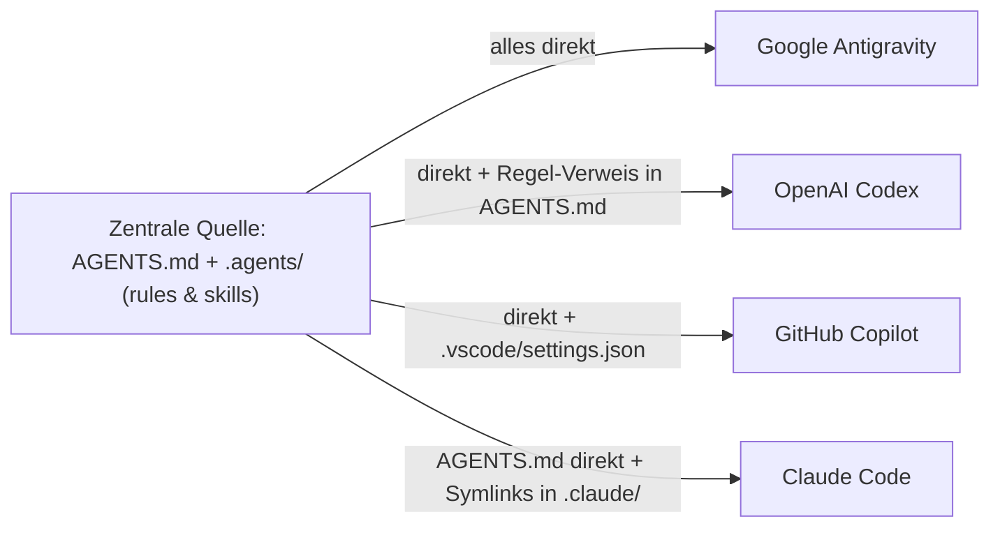

# KI-Harnesses im Projekt: Gemeinsame Konfiguration und Zusammenspiel

Dieses Dokument erklärt, wie die vier im Projekt genutzten KI-Harnesses (**Claude Code**,
**GitHub Copilot in VS Code**, **OpenAI Codex** und **Google Antigravity**) zusammenarbeiten,
welche Änderungen du einfach per Chat beauftragen kannst und wo du nachschauen musst, wenn du
zwischen den Tools wechselst.

---

## 1. Überblick: Der Ist-Zustand im Repository

Projektanweisungen, dateispezifische Regeln und Skills werden nur an **einer** zentralen Stelle
gepflegt (**`AGENTS.md`** und **`.agents/`**). Alle vier Harnesses greifen direkt oder über
Symlinks bzw. Einstellungen auf dieselben Dateien zu.

### 1.1 Ordnerbaum

```text
<repo-root>/
├── AGENTS.md                                  # 📄 Projektweite Anweisungen (alle 4 Harnesses)
├── .agents/                                   # 📁 Zentrale Quelle für Regeln und Skills
│   ├── rules/
│   │   └── python.instructions.md             # 📄 Python-Regel (Antigravity, Copilot, Claude, Codex)
│   └── skills/
│       └── onboarding/
│           └── SKILL.md                       # 📄 Geführtes 5-Stationen-Onboarding nach der Einrichtung
├── .claude/                                   # 📁 Echter Ordner (für settings.local.json & Worktrees)
│   ├── rules  -> ../.agents/rules             # 🔗 Ordner-Symlink für Claude Code
│   ├── skills -> ../.agents/skills            # 🔗 Ordner-Symlink für Claude Code
│   └── settings.local.json                    # 🔒 Lokale Freigaben/Settings (wird von Git ignoriert)
├── .github/
│   └── copilot-instructions.md -> ../AGENTS.md # 🔗 Datei-Symlink (u. a. für Copilot auf GitHub.com)
└── .vscode/
    └── settings.json                          # ⚙ Bindet .agents/rules ein, schaltet .claude/rules für VS Code aus
```

### 1.2 Zusammenspiel im Überblick



### 1.3 Gemeinsam: Wie alle vier Tools im Repo zusammenspielen

| Was | Claude Code | OpenAI Codex | GitHub Copilot (VS Code) | Google Antigravity |
|---|---|---|---|---|
| **Eigener Ordner** | `.claude/` (echter Ordner mit 2 Symlinks) | `.codex/` (erst bei Bedarf) | `.github/` + `.vscode/` | `.agents/` (der gemeinsame Ordner) |
| **Projektweite Anweisungen** | 📄 `AGENTS.md` (keine `CLAUDE.md` anlegen) | 📄 `AGENTS.md` | 📄 `AGENTS.md` (+ 🔗 `.github/copilot-instructions.md` für GitHub.com) | 📄 `AGENTS.md` |
| **Dateispezifische Regeln** | 🔗 `.claude/rules` → `../.agents/rules` | ↪ Verweis in `AGENTS.md` (liest Datei bei Bedarf) | ⚙ `.agents/rules/` über `chat.instructionsFilesLocations` in `.vscode/settings.json` | 📄 `.agents/rules/python.instructions.md` |
| **Skills** | 🔗 `.claude/skills` → `../.agents/skills` | 📄 `.agents/skills/` | 📄 `.agents/skills/` | 📄 `.agents/skills/` |
| **Hooks** | `.claude/settings.json` ruft gemeinsames Skript auf (z. B. `.agents/hooks/*.py`) | `.codex/hooks.json` ruft Skript auf | liest in VS Code `.claude/settings.json` mit (`.github/hooks/*.json` für CLI/GitHub.com) | `.agents/hooks.json` ruft Skript auf |
| **Team-Einstellungen** | `.claude/settings.json` | `.codex/config.toml` | `.vscode/settings.json` | `.agents/*.json` (Manifeste, `mcp_config.json`), in der IDE auch `.vscode/settings.json` |
| **Befehlsfreigaben** | `permissions` in `.claude/settings.json` | `.codex/rules/*.rules` | VS-Code-Einstellungen / UI | App-UI / CLI `/permissions` (`action(target)` + Sandbox); im Repo per Hook in `.agents/hooks.json` |
| **Persönlich / lokal (nicht ins Repo)** | `~/.claude/`, `.claude/settings.local.json` (**kein** `CLAUDE.local.md`!) | `~/.codex/`, `~/.agents/skills` | `~/.copilot/` | `~/.gemini/config/`, `~/.gemini/AGENTS.md`, `~/.gemini/antigravity-cli/settings.json` |

*Legende:* 📄 echte Datei bzw. echter Ordner · 🔗 Symlink · ↪ Verweis im Text · ⚙ über eine Einstellung

---

## 2. Praxis-Leitfaden: Anpassen per Chat & wo man selbst hinschaut

Da alle vier Harnesses beim Start `AGENTS.md` lesen, kennen sie den Aufbau dieses Repositories
bereits. Du musst Dateinamen oder Frontmatter-Felder nicht selbst im Kopf behalten.

### 2.1 Was du einfach im Chat beauftragen kannst

Sag dem aktiven Agenten im Chat einfach, was geändert werden soll – egal ob du gerade in Claude
Code, Copilot, Codex oder Antigravity arbeitest:

- **Projektweite Regeln ändern:** *„Ergänze in den Projektanweisungen, dass …“*
  → Der Agent passt `AGENTS.md` an; für alle vier Tools sofort aktiv.
- **Neue Regel für bestimmte Dateitypen anlegen:** *„Leg eine Regel für Markdown-/Test-Dateien an,
  die … prüft.“*
  → Der Agent legt `.agents/rules/<name>.instructions.md` mit dem kombinierten Header für alle
  Tools an und verweist in `AGENTS.md` kurz darauf (damit auch Codex sie kennt).
- **Skill erstellen oder anpassen:** *„Erstell mir einen Skill für …“*
  → Der Agent legt `.agents/skills/<name>/SKILL.md` an; durch den Symlink in `.claude/skills`
  steht er sofort in allen vier Tools bereit.
- **Regeln nur für einen bestimmten Unterordner:** *„Leg für den Ordner `docs/…` fest, dass …“*
  → Der Agent legt dort eine `context.md` an.

### 2.2 Worauf du selbst achten musst (und wo du bei Tool-Wechsel suchst)

Einige Dinge lassen sich nicht über alle vier Tools vereinheitlichen oder betreffen deine lokale
Umgebung:

1. **Kein `/init` für `CLAUDE.md` oder `GEMINI.md` ausführen:**
   Wenn ein Tool anbietet, eine eigene `CLAUDE.md`, `CLAUDE.local.md` oder `GEMINI.md` zu
   erzeugen, immer ablehnen. Sobald eine `CLAUDE.md` (oder `CLAUDE.local.md`) existiert, ignoriert
   Claude Code die gemeinsame `AGENTS.md`.
2. **Befehlsfreigaben („Immer erlauben“) gelten nur pro Tool:**
   Wenn du einem Agenten erlaubst, bestimmte Terminal-Befehle (wie `uv run pytest` oder `git status`)
   ohne Nachfrage auszuführen, speichert jedes Tool das an seinem eigenen Ort:
   - **Claude Code:** lokal in `.claude/settings.local.json` (oder fürs Team in `.claude/settings.json`)
   - **OpenAI Codex:** in `.codex/rules/*.rules` (oder `~/.codex/rules/`)
   - **Google Antigravity:** in den Projekteinstellungen der App (`Settings > Projects`) bzw. per
     `/permissions` in `~/.gemini/antigravity-cli/settings.json`
   - **GitHub Copilot:** in den VS-Code-Einstellungen
3. **Hooks einrichten (automatische Prüfskripte):**
   Während Regeln in `AGENTS.md` nur „weiche“ Textanweisungen sind, die ein Sprachmodell in langen
   Sitzungen vergessen kann, führen Hooks deterministische kleine Skripte aus, die Aktionen bei
   Fehlern hart blockieren können.
   - **Beispiel (Traceability im Systems Engineering):** Vor dem Öffnen eines Pull Requests (`gh pr create`)
     prüft ein kurzes Python-Skript (z. B. `.agents/hooks/check_traceability.py`), ob jede
     Anforderungs-ID in `docs/requirements/` auch in einem Dokument unter `docs/architecture/`
     verknüpft ist. Fehlt eine Verknüpfung, bricht der Hook den PR-Befehl mit einer klaren
     Fehlermeldung ab, sodass der Agent die Verlinkung erst nachzieht.
   - **Gemeinsame Pflege:** Die eigentliche Prüflogik liegt nur einmal als Skript unter
     `.agents/hooks/` – in den Hook-Dateien der Tools (`.claude/settings.json`, `.codex/hooks.json`,
     `.agents/hooks.json`) steht jeweils nur der kurze Aufruf dieses Skripts.

---

## 3. Vergleich: Wo jedes Tool von Haus aus sucht (Einzelsicht)

Falls du nachschlagen möchtest, wo die vier Tools **ohne** unsere gemeinsame Struktur standardmäßig
suchen:

| Was | Claude Code | OpenAI Codex | GitHub Copilot | Google Antigravity |
|---|---|---|---|---|
| **Eigener Projektordner** | `.claude/` | `.codex/` | `.github/` (+ `.vscode/` in VS Code) | `.agents/` |
| **Projektweite Anweisungen** | `CLAUDE.md` oder `.claude/CLAUDE.md`; sonst `AGENTS.md` | `AGENTS.md` (`AGENTS.override.md` hat Vorrang) | `.github/copilot-instructions.md` oder `AGENTS.md` | `AGENTS.md` oder `GEMINI.md`, auch in `.agents/` |
| **Dateispezifische Regeln** | `.claude/rules/*.md` (Feld `paths`) | gibt es nicht | `.github/instructions/*.instructions.md` (Feld `applyTo`) | `.agents/rules/*.md` (Felder `trigger: glob` + `globs`) |
| **Skills** | `.claude/skills/<name>/SKILL.md` | `.agents/skills/<name>/` | `.github/skills/`, `.claude/skills/`, `.agents/skills/` | `.agents/skills/<name>/` |
| **Hooks** | `.claude/settings.json` (Schlüssel `hooks`) | `.codex/hooks.json` oder `.codex/config.toml` | `.github/hooks/*.json` (+ in VS Code `.claude/settings.json`) | `.agents/hooks.json` |
| **Team-Einstellungen** | `.claude/settings.json` | `.codex/config.toml` | `.vscode/settings.json` (in VS Code) | `.agents/{rules,skills,agents,plugins}.json`, `.agents/mcp_config.json`, `.gemini/config.json` |
| **Befehlsfreigaben** | `permissions` in `.claude/settings.json` | `.codex/rules/*.rules` | VS-Code-Settings / UI | `action(target)` (`allow`/`ask`/`deny`) + Terminal-Sandbox in App-UI / CLI `/permissions` |
| **Persönlich / global** | `~/.claude/`, `.claude/settings.local.json`, `CLAUDE.local.md` | `~/.codex/`, `~/.agents/skills` | `~/.copilot/` | `~/.gemini/config/`, `~/.gemini/AGENTS.md`, `~/.gemini/antigravity-cli/settings.json` |

---

## 4. Warum ist das so gebaut? (Hintergrund wichtiger Entscheidungen)

1. **Warum `.claude/` ein echter Ordner mit zwei Einzel-Symlinks ist (statt `.claude` → `.agents`):**
   Claude Code verweigert das Erstellen von Git-Worktrees, sobald `.claude` selbst ein Symlink ist.
   Außerdem würde ein Komplett-Symlink beim `git pull` eine vorhandene `.claude/settings.local.json`
   löschen und neue persönliche Freigaben ungeschützt (nicht gitignored) unter `.agents/` ablegen.
2. **Warum Regeldateien auf `.instructions.md` enden und in `.vscode/settings.json` der Eintrag `".claude/rules": false` steht:**
   VS Code erkennt in zusätzlichen Regel-Ordnern (`.agents/rules`) nur Dateien mit der Endung
   `.instructions.md`, während Claude Code und Antigravity jede `.md`-Datei lesen. Da VS Code bei
   Regel-Ordnern keine Symlinks dedupliziert, verhindert `".claude/rules": false`, dass dieselbe
   Regel gleichzeitig über `.agents/rules` und den Symlink `.claude/rules` doppelt geladen wird.
3. **Warum neue Regeln zusätzlich kurz in `AGENTS.md` erwähnt werden:**
   OpenAI Codex kennt keinen `rules/`-Ordner (seine `.codex/rules/` sind reine
   Befehlsfreigaben). Über den kurzen Verweis in `AGENTS.md` weiß auch Codex, welche Regeldatei es
   beim Bearbeiten entsprechender Dateien lesen soll.
4. **Warum Symlinks unter Windows per `cmd /c mklink /D` angelegt werden:**
   In Windows PowerShell 5.1 verlangt `New-Item -ItemType SymbolicLink` selbst bei eingeschaltetem
   Entwicklermodus Administratorrechte. `cmd /c mklink /D` (oder `ln -s` in Git Bash mit
   `MSYS=winsymlinks:nativestrict`) funktioniert dagegen ohne Administratorrechte.

